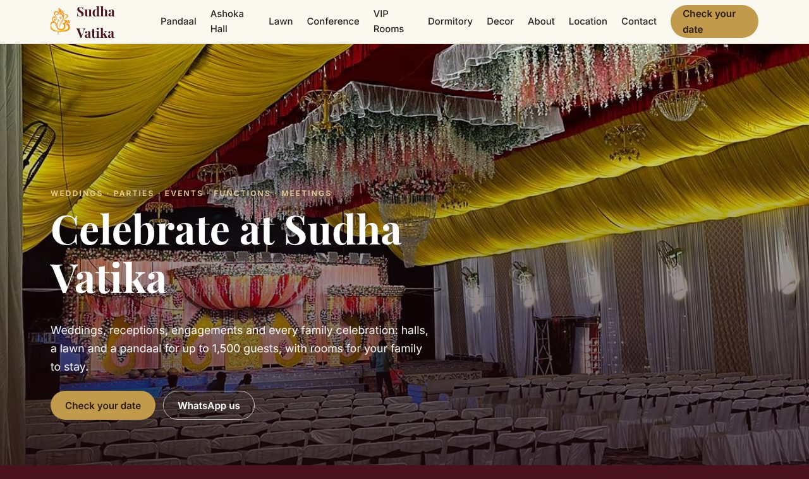
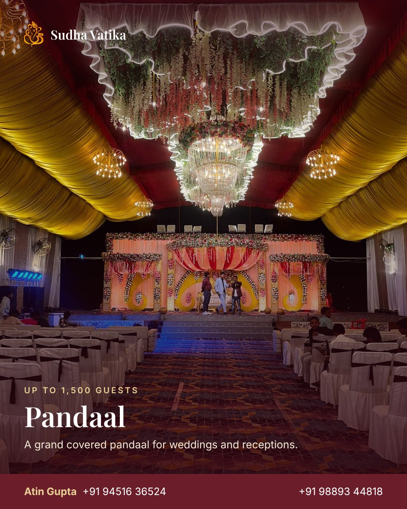
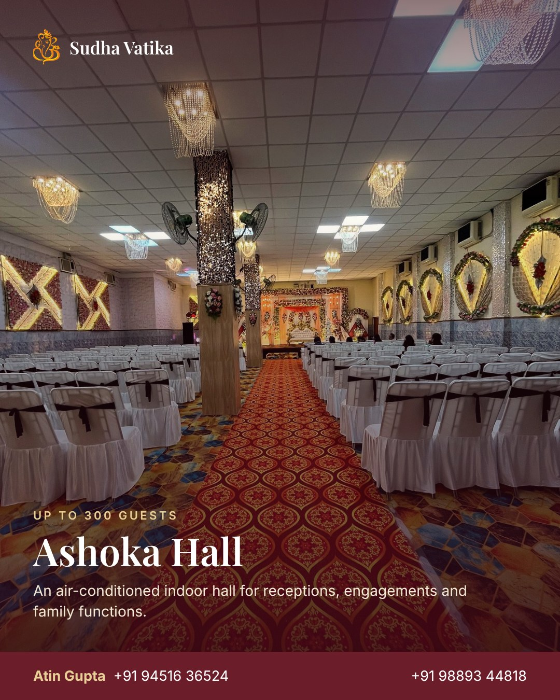
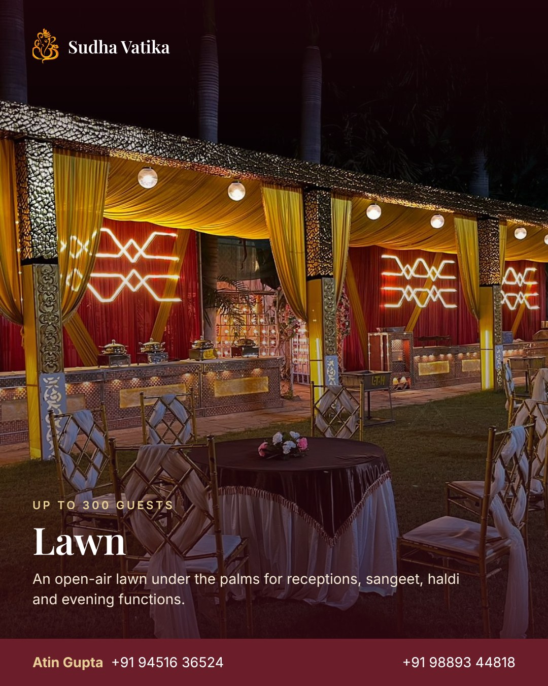
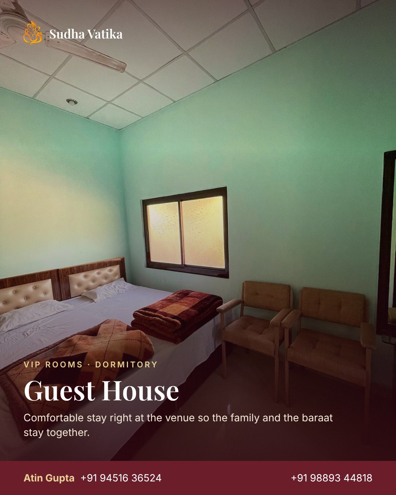
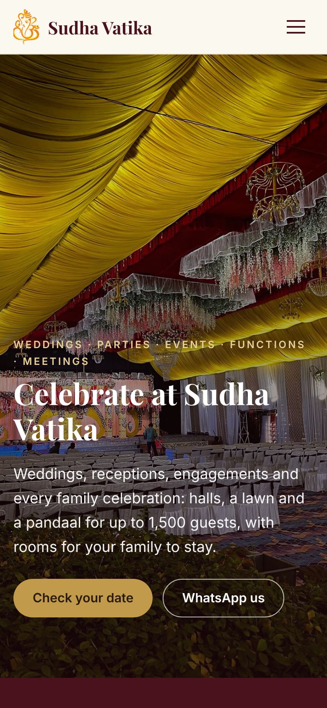
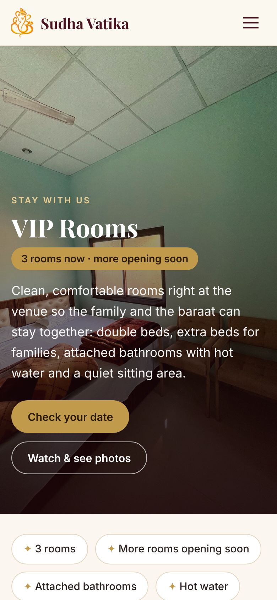
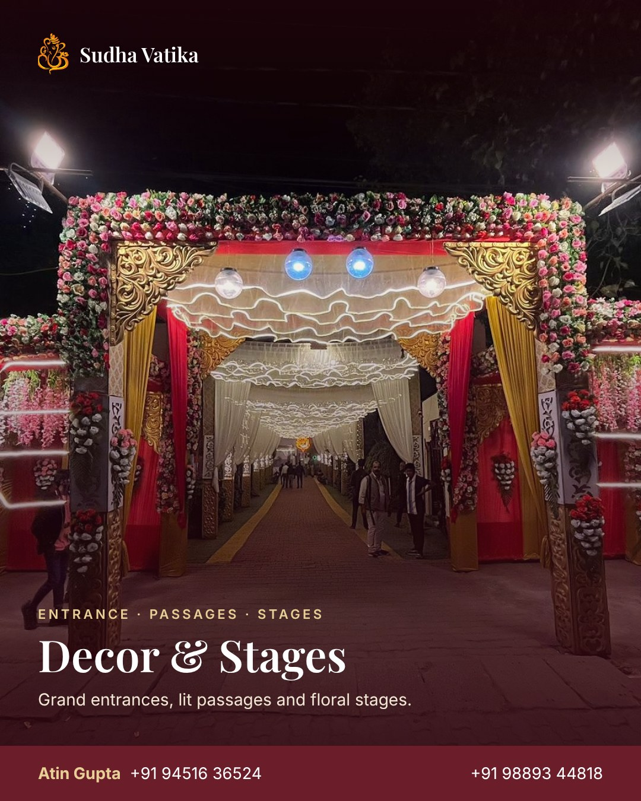
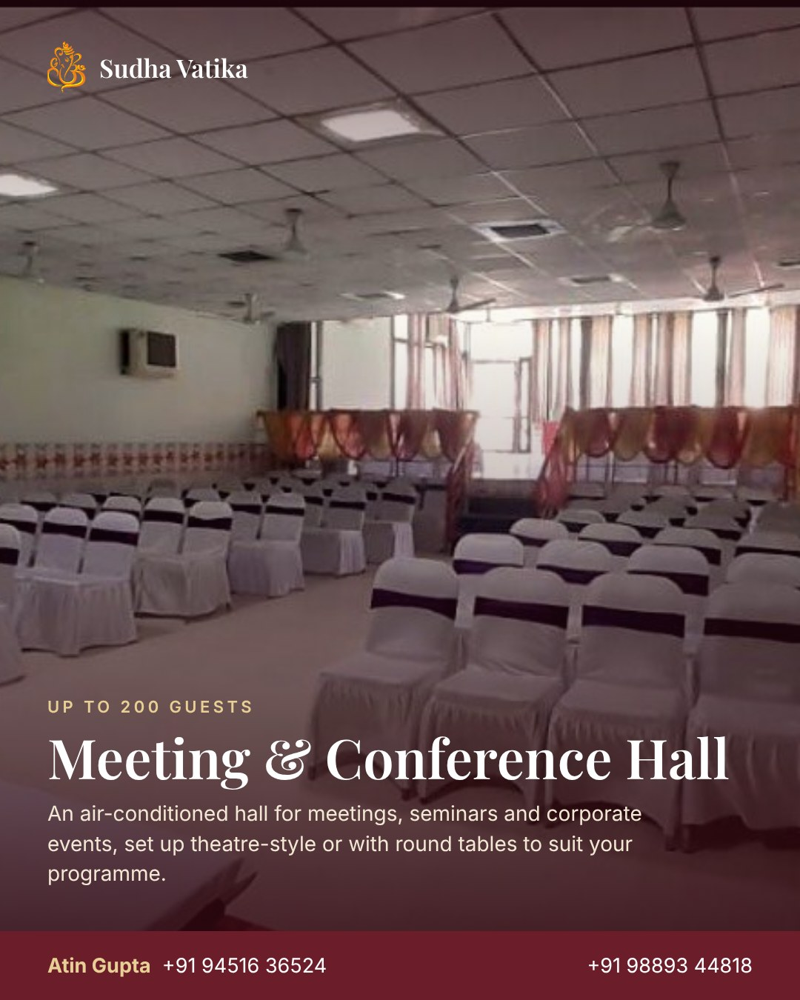

<div align="center">

# Sudha Vatika

**Banquet halls, lawn, pandaal and guest house in Prayagraj**
Weddings · Receptions · Parties · Functions · Meetings

[](https://kushagra486.github.io/Sudha-Vatika-/)
[](https://sudha-vatika.vercel.app)
[](#-android-apps)

[](https://kushagra486.github.io/Sudha-Vatika-/)

</div>

> This repository holds everything for Sudha Vatika: the **public website**, the **staff dashboard** (Banquet Manager), the **Android apps**, and the **brochures and posters**. The dashboard's product name is configurable with `VITE_APP_NAME`.

## Contents

[Links](#-all-links) · [About](#-about-sudha-vatika) · [Room guide](#-room-guide-for-hotel-guests) · [Gallery](#-gallery) · [Downloads](#-downloads) · [Android apps](#-android-apps) · [How it fits together](#-how-it-fits-together) · [Dashboard and logins](#-staff-dashboard-and-logins) · [Hosting](#-hosting) · [For developers](#for-developers)

## 🔗 All links

| What                                    | For                                 | Link                                                         |
| --------------------------------------- | ----------------------------------- | ------------------------------------------------------------ |
| **Website**                             | Customers                           | https://kushagra486.github.io/Sudha-Vatika-/                 |
| **Enquiry form**                        | Customers                           | https://kushagra486.github.io/Sudha-Vatika-/enquiry.html     |
| **Staff dashboard**                     | Owners and staff (sign-in required) | https://sudha-vatika.vercel.app                              |
| **Instagram**                           | Everyone                            | https://www.instagram.com/sudha.vatika                       |
| **Google Maps**                         | Everyone                            | https://maps.app.goo.gl/UULQUpDEhLZk1mDw8                    |
| **Save our contact (vCard)**            | Everyone                            | https://kushagra486.github.io/Sudha-Vatika-/sudha-vatika.vcf |
| **Source code**                         | Developers                          | https://github.com/kushagra486/Sudha-Vatika-                 |
| Old dashboard address (Netlify, legacy) | Staff                               | https://sudha-vatika.netlify.app                             |
| Old website address (Netlify, legacy)   | Customers                           | https://sudhavatika.netlify.app                              |

Website pages: [Pandaal](https://kushagra486.github.io/Sudha-Vatika-/pandaal.html) · [Ashoka Hall](https://kushagra486.github.io/Sudha-Vatika-/ashoka-hall.html) · [Lawn](https://kushagra486.github.io/Sudha-Vatika-/lawn.html) · [Conference Hall](https://kushagra486.github.io/Sudha-Vatika-/conference.html) · [VIP Rooms](https://kushagra486.github.io/Sudha-Vatika-/rooms.html) · [Dormitory](https://kushagra486.github.io/Sudha-Vatika-/dormitory.html) · [Decor](https://kushagra486.github.io/Sudha-Vatika-/decor.html) · [About](https://kushagra486.github.io/Sudha-Vatika-/about.html) · [Location](https://kushagra486.github.io/Sudha-Vatika-/location.html) · [Contact](https://kushagra486.github.io/Sudha-Vatika-/contact.html)

<p align="center"><br><sub>Scan to open the website</sub></p>

## 🏛️ About Sudha Vatika

Sudha Vatika is a family-run venue on the old Kanpur Road in Dhoomanganj, Prayagraj. It hosts weddings, receptions, engagements, parties, functions and meetings, and keeps everything in one place: a grand pandaal, an air-conditioned hall, an open lawn, a meeting hall, a guest house for the family, and an in-house decor team.

### Banquet and event spaces

| Space                         | Guests      | What it is                                                                                                         |
| ----------------------------- | ----------- | ------------------------------------------------------------------------------------------------------------------ |
| **Pandaal**                   | up to 1,500 | Covered pandaal with golden drapes, crystal chandeliers, hanging-flower canopies, a floral stage and a dance floor |
| **Ashoka Hall**               | up to 300   | Air-conditioned hall with chandeliers, lit floral wall panels and a decorated stage                                |
| **Lawn**                      | up to 300   | Open-air lawn under the palms with lit pavilions and lounge seating                                                |
| **Meeting & Conference Hall** | up to 200   | Air-conditioned hall, theatre-style or round-table seating, head table and stage                                   |

### Guest House (hotel stay)

Rooms for the family and the baraat, right at the venue.

- **VIP rooms:** 3 rooms now, more opening soon. Double beds, extra beds for families, attached bathrooms with hot water, a quiet sitting area, AC rooms available.
- **Dormitory:** shared stay for larger groups, with beds, fresh linen, blankets, fans and shared washrooms.
- Meals are **not** included with a stay. Food and catering are arranged only on request.

### Decor

Flower-covered entrance gates, lit canopy passages and floral stage sets, styled to your theme by the venue's own decor team.

### Contact and location

- **Contact person:** Atin Gupta
- **Phone / WhatsApp:** +91 94516 36524 · +91 98893 44818
- **Address:** 58 A/31 Dhoomanganj, Old N.H.-02 (Kanpur Road), near Dhoomanganj Police Station, Prayagraj (Allahabad), Uttar Pradesh 211011
- **Getting here:** about 3 km from Subedarganj station and 7 km from Prayagraj Junction
- **Instagram:** [@sudha.vatika](https://www.instagram.com/sudha.vatika) · **Maps:** [open in Google Maps](https://maps.app.goo.gl/UULQUpDEhLZk1mDw8)

Prices are not published online. Call, WhatsApp or send an enquiry and the team will get back to you, usually the same day.

## 🛎️ Room guide for hotel guests

A QR code in each room opens **https://kushagra486.github.io/Sudha-Vatika-/room/**, a large-icon page that replaces the room phone. It lives next to the website but is a separate app, so the official website is untouched.

| Guests can                                                 | Details                                                                                                                                                                                                     |
| ---------------------------------------------------------- | ----------------------------------------------------------------------------------------------------------------------------------------------------------------------------------------------------------- |
| **Call or WhatsApp Reception**                             | One tap, any time                                                                                                                                                                                           |
| **Ask for Housekeeping, Luggage help, Repairs, Help Desk** | Big option buttons, then Send. Goes straight to the dashboard                                                                                                                                               |
| **Food and drinks on request**                             | Tell the team what they want. Plus **Order Food Online**: nearby restaurants with phone numbers, veg filter and delivery-app buttons                                                                        |
| **WiFi**                                                   | Name and password (shown after they enter room number and name)                                                                                                                                             |
| **Explore Prayagraj**                                      | Picture tiles for temples, sights, markets, stations, airport, bus stands and areas. Each place has a readable page with the best time to go and its own map. A one-day plan shows all stops on a route map |
| **Follow their requests**                                  | "My requests" shows Received, On the way, Done                                                                                                                                                              |
| **Rate their stay**                                        | Stars, comments, and a few quick ratings                                                                                                                                                                    |

- **No password**: guests only give a **room number and a name**, so staff know who is asking and for what. It works in English and Hindi.
- **Staff side**: the dashboard's **Room desk** shows new requests (with a one-tap "On it" and "Done"), reviews with averages, the restaurant list, and the WiFi, check-out time and note that guests see.
- **QR cards**: [one card for every room](https://kushagra486.github.io/Sudha-Vatika-/room/cards/Sudha-Vatika-Room-Card.pdf) (A5, English and Hindi). `node room-guide/tools/make_room_cards.mjs 101 102 103` makes a card per room with the room number filled in.
- **Changing things**: phone numbers and links are in `room-guide/config.js`; places in `room-guide/places.js` and `room-guide/place-details.js`; restaurants, WiFi and check-out time are edited in the dashboard, no code needed.

### Photos still needed (5 of 36 places)

The room guide shows an icon tile for these places until a photo is added. Photos must be ones we may use: your own pictures, or Wikimedia Commons files with a free licence (the credit shows under the photo).

**🏛️ Sights and history**

- Allahabad Museum (id: `museum`)

**🛤️ Areas and paths**

- Daraganj (old pilgrim quarter) (id: `daraganj`)
- Johnstonganj (id: `johnstonganj`)
- Lukerganj (id: `lukerganj`)
- Triveni Road (the road to the Sangam) (id: `triveniroad`)

To add one: put the picture in `room-guide/places/<id>.jpg` (about 800 pixels wide), add its entry (credit, licence, link) to `room-guide/images.js`, and note it in `room-guide/places/CREDITS.md`.

## 🖼️ Gallery

<p align="center">
  
  
  
  
</p>

<p align="center">
  
  
  
  
</p>

## 📥 Downloads

All files open straight from the website. No prices and no food in any of them.

| File                                | Format | Download                                                                                                                                                                                                                                                                                                                                                                                                                                                                                                                                           |
| ----------------------------------- | ------ | -------------------------------------------------------------------------------------------------------------------------------------------------------------------------------------------------------------------------------------------------------------------------------------------------------------------------------------------------------------------------------------------------------------------------------------------------------------------------------------------------------------------------------------------------- |
| **Full brochure** (8 pages)         | PDF    | [Sudha-Vatika-Brochure.pdf](https://kushagra486.github.io/Sudha-Vatika-/downloads/Sudha-Vatika-Brochure.pdf)                                                                                                                                                                                                                                                                                                                                                                                                                                       |
| Pandaal sheet                       | PDF    | [Pandaal](https://kushagra486.github.io/Sudha-Vatika-/downloads/Sudha-Vatika-Pandaal-Sheet.pdf)                                                                                                                                                                                                                                                                                                                                                                                                                                                    |
| Ashoka Hall sheet                   | PDF    | [Ashoka Hall](https://kushagra486.github.io/Sudha-Vatika-/downloads/Sudha-Vatika-Ashoka-Hall-Sheet.pdf)                                                                                                                                                                                                                                                                                                                                                                                                                                            |
| Lawn sheet                          | PDF    | [Lawn](https://kushagra486.github.io/Sudha-Vatika-/downloads/Sudha-Vatika-Lawn-Sheet.pdf)                                                                                                                                                                                                                                                                                                                                                                                                                                                          |
| Conference Hall sheet               | PDF    | [Conference Hall](https://kushagra486.github.io/Sudha-Vatika-/downloads/Sudha-Vatika-Meeting-and-Conference-Hall-Sheet.pdf)                                                                                                                                                                                                                                                                                                                                                                                                                        |
| Guest House sheet                   | PDF    | [Guest House](https://kushagra486.github.io/Sudha-Vatika-/downloads/Sudha-Vatika-Guest-House-Sheet.pdf)                                                                                                                                                                                                                                                                                                                                                                                                                                            |
| Decor and stages sheet              | PDF    | [Decor](https://kushagra486.github.io/Sudha-Vatika-/downloads/Sudha-Vatika-Decor-and-Stages-Sheet.pdf)                                                                                                                                                                                                                                                                                                                                                                                                                                             |
| **Showreel** (43 seconds, no sound) | MP4    | [Sudha-Vatika-Showreel.mp4](https://kushagra486.github.io/Sudha-Vatika-/downloads/Sudha-Vatika-Showreel.mp4)                                                                                                                                                                                                                                                                                                                                                                                                                                       |
| Welcome poster (portrait / square)  | JPG    | [portrait](https://kushagra486.github.io/Sudha-Vatika-/downloads/poster-welcome.jpg) · [square](https://kushagra486.github.io/Sudha-Vatika-/downloads/poster-welcome-square.jpg)                                                                                                                                                                                                                                                                                                                                                                   |
| Space posters                       | JPG    | [Pandaal](https://kushagra486.github.io/Sudha-Vatika-/downloads/poster-pandaal.jpg) · [Ashoka Hall](https://kushagra486.github.io/Sudha-Vatika-/downloads/poster-ashoka-hall.jpg) · [Lawn](https://kushagra486.github.io/Sudha-Vatika-/downloads/poster-lawn.jpg) · [Conference](https://kushagra486.github.io/Sudha-Vatika-/downloads/poster-conference-hall.jpg) · [Guest House](https://kushagra486.github.io/Sudha-Vatika-/downloads/poster-guest-house.jpg) · [Decor](https://kushagra486.github.io/Sudha-Vatika-/downloads/poster-decor.jpg) |
| Contact card                        | vCard  | [sudha-vatika.vcf](https://kushagra486.github.io/Sudha-Vatika-/sudha-vatika.vcf)                                                                                                                                                                                                                                                                                                                                                                                                                                                                   |

These files are rebuilt from the website's photos and videos with `python3 site/tools/make_marketing_kit.py`.

## 📱 Android apps

Two small Android apps open the live pages full screen. Because they load the live pages, website and dashboard updates show up in the apps automatically.

| App                        | For                   | Download                                                                                                            |
| -------------------------- | --------------------- | ------------------------------------------------------------------------------------------------------------------- |
| **Sudha Vatika** (website) | Customers and anyone  | [Sudha-Vatika-Website.apk](https://kushagra486.github.io/Sudha-Vatika-/downloads/apps/Sudha-Vatika-Website.apk)     |
| **Sudha Vatika Dashboard** | Owners and staff only | [Sudha-Vatika-Dashboard.apk](https://kushagra486.github.io/Sudha-Vatika-/downloads/apps/Sudha-Vatika-Dashboard.apk) |

**Install on a phone**

1. Open the download link on the phone (or send the file over WhatsApp or Drive and tap it).
2. If Android asks, allow **Install unknown apps** for that app or browser.
3. Tap **Install**, then open the app from the home screen.

**Good to know**

- These are test-signed APKs for direct sharing. A Play Store listing needs a Google developer account and a release-signed build.
- The apps need an internet connection. Offline, they show a short page with the phone number.
- The dashboard app asks for a login like the web version. Staff should use **email and password**, because emailed sign-in links open in the phone's browser.
- Fresh builds: GitHub → Actions → **Build Android app** or **Build Android dashboard app** → latest run → Artifacts.
- **No app needed:** open the website or dashboard in any browser (Chrome, Edge, Safari, Firefox). In Chrome, menu → **Add to Home screen** puts it on the phone like an app.

## 🧩 How it fits together

```
 Customer ──► Website (GitHub Pages) ──► enquiry form ──► Supabase Edge Function
                                                              │
                              ┌───────────────────────────────┴───────────────┐
                              ▼                                               ▼
                 Lead + guest in the database                    Email alert to both owners
                              │                                  (with the customer's details)
                              ▼
          Staff dashboard (Vercel) ◄── Android dashboard app
```

- A website enquiry becomes a **lead** in the dashboard with the full details: name, phone, WhatsApp number (or "same as phone"), event, date, guests, space, stay and questions.
- An email alert goes to both owners for every new enquiry.
- Default photos, videos and PDFs for each space are in the dashboard's **Media** library, ready to share on WhatsApp.

## 🔐 Staff dashboard and logins

The dashboard is for the owners and staff: enquiries and follow-ups, bookings and payments, room and dorm stays, guests, WhatsApp messages and templates, media, reports and an assistant. It also has a Hindi option.

**Login details are private and are never kept in this repository.**

- Only the owners can create or reset accounts (Settings → Team). Ask an owner for access.
- Sign in with your own email, using **email and password** or a **sign-in link**.
- Never put passwords, keys or tokens in this README, in code, or in chat. Secrets live in Supabase and Vercel settings.
- The only key in the web app is Supabase's public key, which is safe to expose by design. Access is enforced by database Row Level Security.

## ☁️ Hosting

| Part                               | Where                                    | Updates when                                                                          |
| ---------------------------------- | ---------------------------------------- | ------------------------------------------------------------------------------------- |
| Website (`site/`)                  | GitHub Pages, from the `gh-pages` branch | `site/` or `room-guide/` changes on `main` (workflow `.github/workflows/website.yml`) |
| Dashboard (`apps/web`)             | Vercel                                   | `main` changes (root folder `apps/web`)                                               |
| Database, logins, files, functions | Supabase                                 | Migrations in `supabase/migrations` and Edge Functions                                |
| Android apps                       | GitHub Actions builds the APKs           | Changes in `android-app/` or `android-dashboard/`                                     |

**Email alerts** need a sending Gmail account with an app password, saved as the Supabase function secrets `GMAIL_USER` and `GMAIL_APP_PASSWORD` (optionally `DASHBOARD_URL`). Without them enquiries are still saved, and the missing email is logged.

---

## For developers

### Quick start

```bash
npm install
cp .env.example .env      # fill in VITE_SUPABASE_URL and VITE_SUPABASE_ANON_KEY
npm run dev
```

See [docs/RUNBOOK.md](docs/RUNBOOK.md) for local Supabase setup, creating the first owner, and deploying. The live database is the Supabase project `Sudha-Vatika-Dashboard` (Mumbai) and the dashboard is at https://sudha-vatika.vercel.app.

### Scripts

| Command           | What it does                                                                             |
| ----------------- | ---------------------------------------------------------------------------------------- |
| `npm run dev`     | Start the web app                                                                        |
| `npm run check`   | Prettier, ESLint, TypeScript and unit tests                                              |
| `npm run test:db` | Apply migrations, seed data and fixtures to a throwaway Postgres, then run the SQL tests |
| `npm run build`   | Production build into `apps/web/dist`                                                    |

### Layout

```
apps/web/            React SPA (the staff dashboard)
site/                Public website (static HTML), plus site/downloads (brochure, posters, APKs)
room-guide/          In-room QR guest page (static), published at /room/
android-app/         Android wrapper for the website
android-dashboard/   Android wrapper for the dashboard
packages/shared/     Zod schemas and helpers shared with Edge Functions
supabase/migrations/ SQL migrations, one concern each
supabase/tests/      RLS and constraint tests
supabase/seed.sql    Sudha Vatika venue, spaces, services, packages
docs/                DECISIONS, RUNBOOK, WHATSAPP_TEMPLATES
```

### Conventions

- Every table has `org_id`, and every query goes through RLS. Design choices are recorded in [docs/DECISIONS.md](docs/DECISIONS.md).
- Money is INR in `numeric(12,2)`. Dates are `Asia/Kolkata`. Phone numbers are E.164.
- UI strings live in `apps/web/src/i18n/en.ts`.
